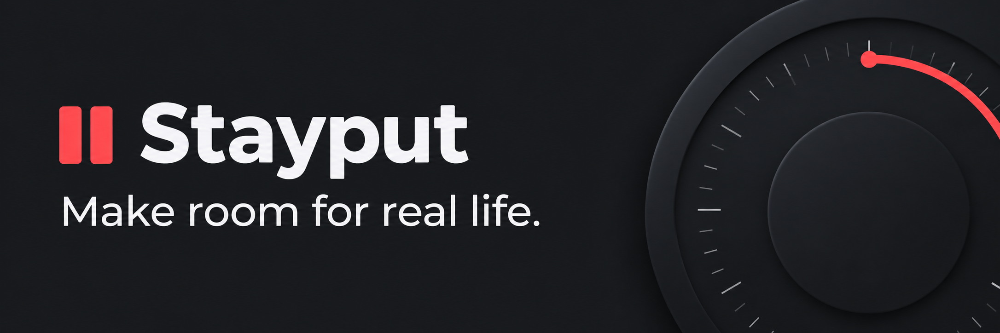
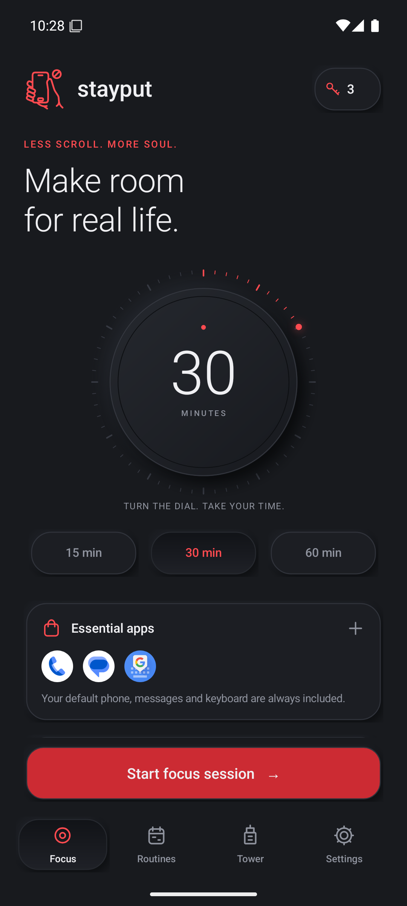
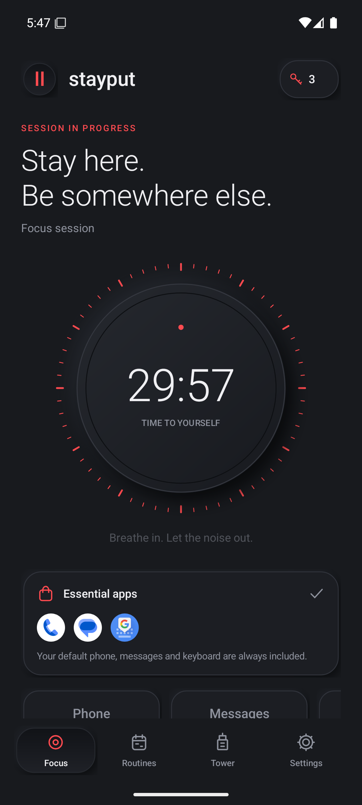
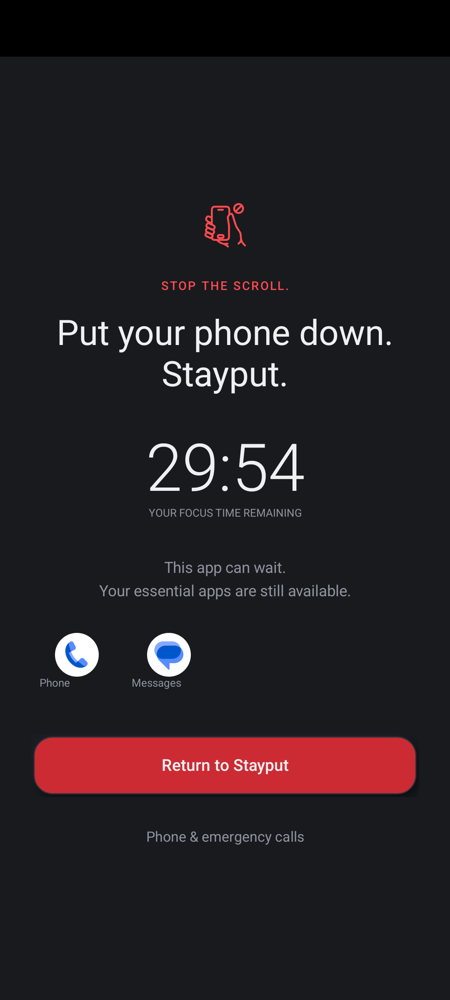
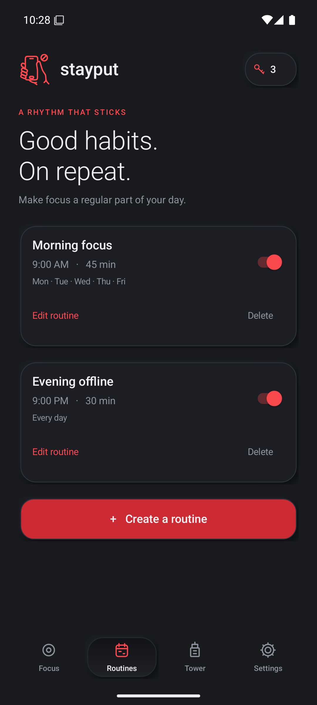
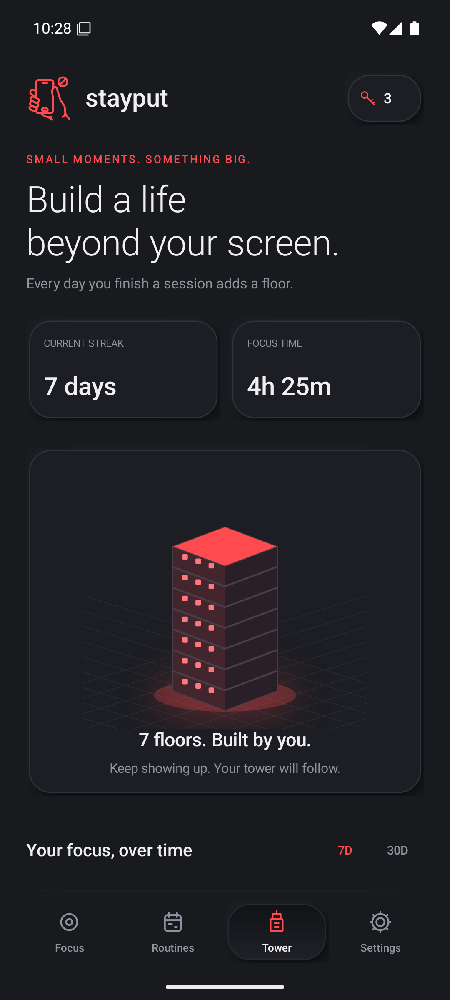
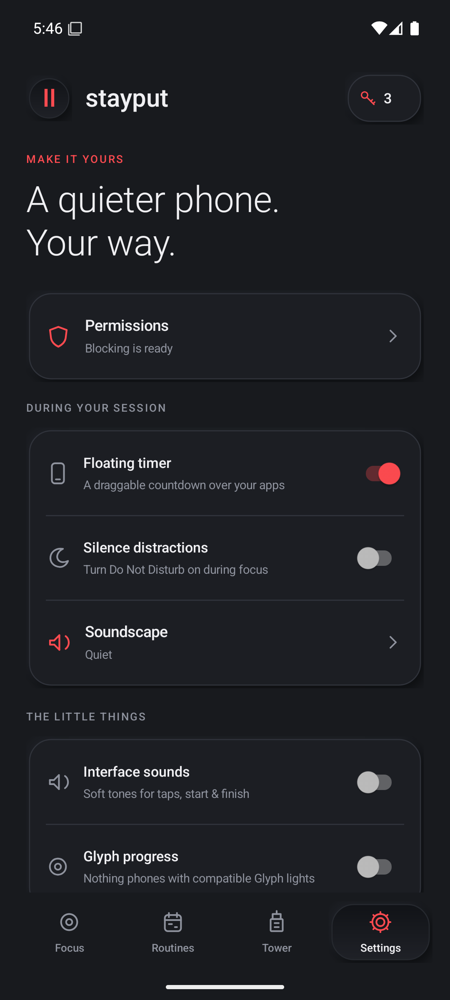
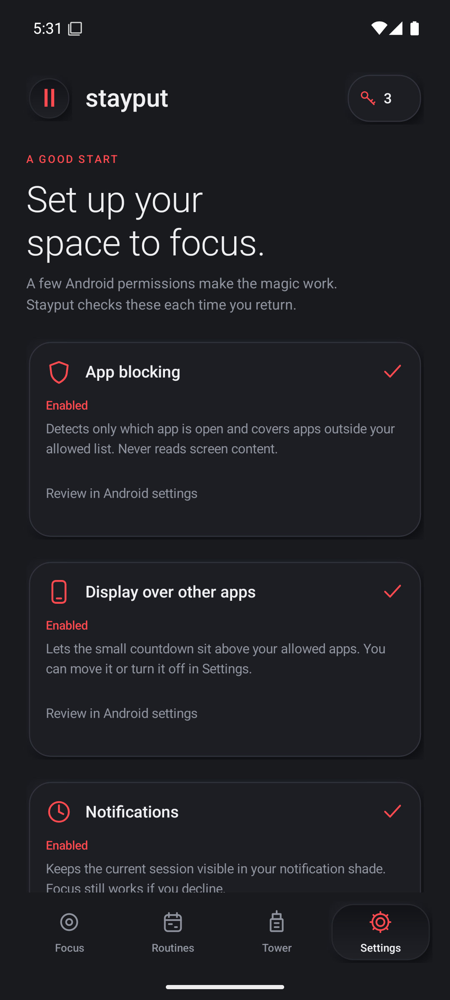
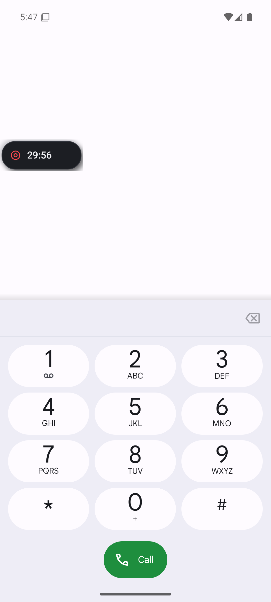

# Stayput

Stop your phone addiction and stayput.

Stayput helps you step away from distracting apps while keeping your phone useful.
Choose a focus duration, pick the extra apps you need, and let the rest take a break.

Your default **Phone, Messages, and keyboard** are always available, including Gboard when it is your selected keyboard.
Finish sessions, build a daily streak, and watch your focus tower grow.

**Android 8.0+** · **Native Android** · **Local data** · **No account or subscription**

[**Download the APK**](https://github.com/ax9-labs/stayput-app/releases) · [Screenshots](#screenshots) · [Set up Stayput](#install-and-set-up) · [Build from source](#build-from-source)

> Stayput is a development preview.
> Open the newest GitHub prerelease and download **Stayput.apk** to try it.

## How it works

1. **Keep your essentials.**
   Phone, Messages, and your default keyboard are included automatically.
   Add any other apps you want available during focus.
2. **Choose your time.**
   Turn the dial to set a session from 5 to 180 minutes, or use a 15, 30, or 60 minute preset.
3. **Give yourself some space.**
   Opening an app outside your essentials brings up Stayput's blocking screen.
   A floating timer keeps your remaining time visible while you use an allowed app.
4. **Build a habit.**
   Complete a session to record your progress.
   Each day with a completed session adds one floor to your focus tower.

## Screenshots

Actual captures from the current app on an Android 15 emulator, using example routines and session history.
Tap a screenshot to open it at full size.

<table>
  <tr>
    <th>Choose your focus</th>
    <th>Stay with your session</th>
    <th>Pause distractions</th>
  </tr>
  <tr>
    <td><a href="docs/screenshots/current/focus.png"></a></td>
    <td><a href="docs/screenshots/current/session.png"></a></td>
    <td><a href="docs/screenshots/current/blocked-app.png"></a></td>
  </tr>
  <tr>
    <th>Make focus a routine</th>
    <th>Watch your tower grow</th>
    <th>Make it yours</th>
  </tr>
  <tr>
    <td><a href="docs/screenshots/current/routines.png"></a></td>
    <td><a href="docs/screenshots/current/tower.png"></a></td>
    <td><a href="docs/screenshots/current/settings.png"></a></td>
  </tr>
</table>

<details>
<summary>See permission setup and the floating timer</summary>

<table>
  <tr>
    <th>Set up blocking</th>
    <th>Keep time in view</th>
  </tr>
  <tr>
    <td><a href="docs/screenshots/current/permissions.png"></a></td>
    <td><a href="docs/screenshots/current/floating-timer.png"></a></td>
  </tr>
</table>

</details>

## Features

| Feature | What you can do |
| --- | --- |
| **Flexible focus sessions** | Set 5 to 180 minutes with the dial, keyboard controls, accessibility actions, or duration presets. |
| **Automatic essentials** | Keep the device's default Phone, Messages, and keyboard apps available in manual sessions and routines. |
| **Your own whitelist** | Search installed apps and choose additional essentials before a session starts. |
| **Full-screen app blocking** | Get a reminder to return to your session when you open an app outside the allowed list. |
| **Optional scroll check-ins** | Choose how firmly Stayput interrupts repeated swipes through a vertical feed in apps you watch. |
| **Floating countdown** | Drag the timer to a screen edge and reopen Stayput with a tap. |
| **A little more time** | Hold for three seconds to add 15 minutes, or activate the control to confirm an extension. |
| **Recurring routines** | Schedule focus by name, local time, weekdays, duration, and a separate set of essential apps. |
| **Focus tower and history** | Track daily tower floors, streaks, total focus time, 7/30-day charts, and recent sessions. |
| **Soundscapes** | Choose quiet, soft rain, ocean waves, white noise, or distant-city audio. |
| **Optional Do Not Disturb** | Enable priority-only interruptions during a session and restore the previous mode afterward. |
| **Escape Keys** | End a session early with one of three starter demo keys, with free demo refills in the app. |
| **Accessible controls** | Use labeled fields, keyboard and accessibility actions, enlarged text, and Android's reduced-motion setting. |
| **Optional Nothing Glyph** | Show face-down countdown progress on compatible Nothing phones with the required SDK support. |

Automatic apps are marked **Always included** and cannot be unchecked.
They follow the device's current defaults, while your optional selections stay fixed for the active session.
Emergency calling remains available.

Open the **Check-in** tab, turn on **Show check-ins**, pick the apps you want to watch, and choose how long Stayput should wait before asking.
Stayput looks for repeated advances to the next item in a vertical feed that shows one item at a time.
The default delay is 10 minutes from the first detected advance in a run, with pauses of up to a minute between advances.
The pattern depends on scroll information that the watched app provides to Android.
Swipe up or down on the alert or tap **Keep going** to dismiss it.
Under **Check-in intensity**, choose **Gentle** (the default) for one alert per app visit, **Repeat** for another alert after a new interval of repeated swipes, or **Firm** for another alert on the next detected reel advance.
**Time before asking** controls the first alert in all three modes and the interval between alerts in **Repeat**.
Leaving the app or locking the phone starts a fresh check-in.
**Start a cycle** uses the duration on your Focus tab.

Early exits record the time you spent focusing but do not earn a tower floor.
Multiple completed sessions on one day still earn one floor for that day.

Nothing Glyph is experimental and has not been verified on physical Nothing hardware.
See the [validation report](VALIDATION.md) for tested behavior and platform limits.

## Install and set up

1. Open [Releases](https://github.com/ax9-labs/stayput-app/releases), choose the newest build, and download **Stayput.apk** on your Android phone.
2. Open the APK and allow installation from the app you downloaded it with if Android asks.
3. In Stayput, tap **One small setup**, or open **Settings → Permissions**.
4. Enable **Stayput · App blocking** in Android Accessibility settings.
   If Android restricts this for a sideloaded app, open **App info → Stayput → menu → Allow restricted settings**, then return to Accessibility.
5. Allow **Display over other apps** for the floating timer.
6. Choose your extra **Essential apps**, set a duration, and start your first session.

The APKs are signed development builds.
Updates from this project's builds use the same signing identity, so they can preserve your existing app data.

### Permissions at a glance

| Access | When it is used |
| --- | --- |
| **Accessibility app blocking** | Identifies the foreground app and displays the blocking screen or optional scroll check-in. |
| **Display over other apps** | Required by session setup for the floating countdown. |
| **Notifications** | Recommended for session status and routine reminders. |
| **Alarms & reminders** | Recommended for precise scheduled routines; an inexact fallback is available. |
| **Do Not Disturb** | Optional, requested when you enable the setting. |

If setup reports that the accessibility service is enabled but disconnected, turn Stayput off and on in Android's Accessibility settings.
This can happen after a force-stop.

## Privacy and control

- **Everything stays on your device.**
  History, routines, app lists, check-in settings, and demo keys are stored locally.
- **No account, analytics, or internet permission.**
  Stayput's focus features work offline.
- **No screen content access.**
  The accessibility service identifies foreground apps for blocking and uses scroll direction, item positions, and timing in watched apps for check-ins.
  Stayput processes these signals on your device without requesting screen text or saving a scroll history.
- **No contact, location, microphone, or storage permission requests.**
- **You stay in control.**
  Android lets you revoke permissions, force-stop Stayput, or uninstall it.

Clearing app storage or uninstalling removes your local history, routines, and settings.
Android backup is disabled.

## Build from source

Stayput uses **Java and Android framework views**, with **Gradle 8.11.1** and **Android Gradle Plugin 8.9.2**.
Its package name is `app.stayput`, minimum SDK is 26, and compile/target SDK is 35.

Open the project in Android Studio, install Android SDK Platform 35 and Build Tools 35.0.0, then sync and run the `app` configuration.
Use JDK 17 or 21.

**Windows PowerShell**

```powershell
.\gradlew.bat assembleDebug lintDebug
```

**macOS / Linux**

```sh
./gradlew assembleDebug lintDebug
```

The APK is written to `app/build/outputs/apk/debug/app-debug.apk`.
Android Studio creates the ignored `local.properties` SDK configuration, or you can set `ANDROID_HOME`.

### Automatic GitHub builds

Every push to `main`, including a merged pull request, runs the [Android build workflow](https://github.com/ax9-labs/stayput-app/actions/workflows/android-build.yml).
It runs the core checks and lint, builds the APK, verifies its signing certificate, and publishes a GitHub prerelease with:

- `Stayput.apk`
- `SHA256SUMS.txt`
- `build-info.txt` containing the source commit and workflow run

You can also start the workflow manually from the Actions tab with `main` selected.
Workflow APK artifacts are kept for 30 days; release downloads stay available until the release is deleted.

The development keystore is supplied through the repository's `ANDROID_DEBUG_KEYSTORE_BASE64` Actions secret.
The workflow restores it temporarily and removes it after building.
Keep the signing identity consistent for compatible updates.
A production store release needs a separate production signing setup.

### Validation

The latest local validation passed **17 core checks**, **95 device checks**, and **96 device checks at 200% text size with reduced motion**, with **zero Android lint errors or warnings**.
See [VALIDATION.md](VALIDATION.md) for the test environment, evidence, and remaining hardware checks.

Use Git Bash for the shell scripts below when working on Windows.

Run the clock, streak, recurrence, and daylight-saving checks with:

```sh
sh tools/test-core.sh
```

Run device checks on a **disposable emulator**:

```sh
./gradlew assembleDebug assembleDebugAndroidTest
ANDROID_SERIAL=emulator-5554 sh tools/test-device.sh
```

The device runner grants blocking permissions and temporarily replaces app preferences for testing.
It refuses to run against a physical phone.
Results and screenshots are written under the ignored `artifacts/` directory.

<details>
<summary>Project structure</summary>

| File | Responsibility |
| --- | --- |
| [MainActivity.java](app/src/main/java/app/stayput/MainActivity.java) | Screens, app selection, dialogs, and setup. |
| [AutomaticApps.java](app/src/main/java/app/stayput/AutomaticApps.java) | Device-default Phone, Messages, and keyboard discovery. |
| [Store.java](app/src/main/java/app/stayput/Store.java) | Session, routine, history, and whitelist persistence. |
| [BlockService.java](app/src/main/java/app/stayput/BlockService.java) | Foreground timer, audio, Do Not Disturb, and floating overlay. |
| [FocusAccessibilityService.java](app/src/main/java/app/stayput/FocusAccessibilityService.java) | Foreground-app checks and the blocking screen. |
| [RoutineReceiver.java](app/src/main/java/app/stayput/RoutineReceiver.java) | Routine scheduling and session launch. |
| [FocusMath.java](app/src/main/java/app/stayput/FocusMath.java) | Clock, streak, and recurrence rules. |
| [GlyphBridge.java](app/src/main/java/app/stayput/GlyphBridge.java) | Optional Nothing hardware integration. |
| [tools/generate_audio.py](tools/generate_audio.py) | Regeneration of the project's original audio assets. |

</details>

## Current scope

Stayput is designed for voluntary focus.
Android's owner controls, safe mode, and permission settings remain available.

Scheduled sessions depend on Android's alarm and background-execution rules.
Some manufacturers may delay them, and secure screens or other apps can hide overlays.
The app uses the device's local timezone for routines.

The interface is currently English-only.
Cloud synchronization, home screen widgets, and a purchase flow are outside the current build.

## Credits

The optional Glyph integration uses [Nothing's official Glyph SDK](https://github.com/Nothing-Developer-Programme/Glyph-Developer-Kit) at commit `8ee807a9312a640b0d43051450924e3446bc1d78`.
The vendor API is guarded behind Android 14 and compatible-hardware checks.
Stayput's audio assets were synthesized for this project.

The screenshots are unmodified captures from the running app.
