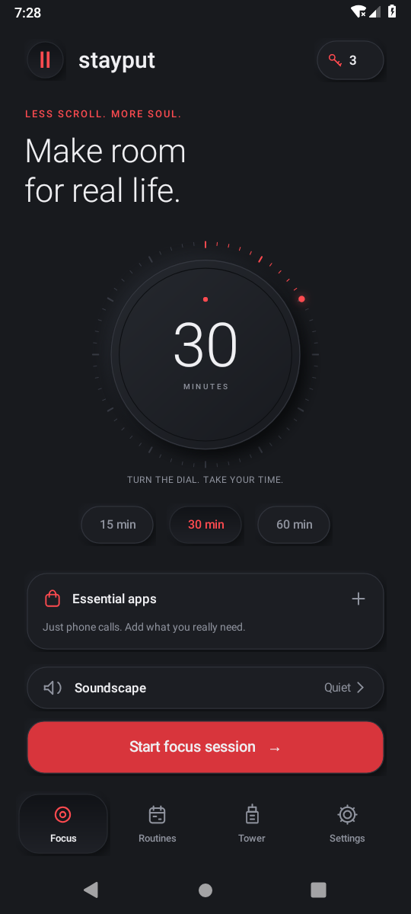

# Stayput

A native Android digital wellbeing MVP with a black and red neumorphic interface. Built with Java and Android framework views, with no web wrapper, analytics, account, or internet permission. Package: `app.stayput`. Android 8.0+ (API 26); targets Android 15 (API 35).



See the [validation report](VALIDATION.md) for tested behavior and known platform limits. More [screenshots](docs/screenshots/) show sessions, app blocking, permissions, routines, and the floating timer.

## Included

- Focus dial, 5–180 minute sessions, duration presets, full-screen accessibility block.
- Searchable installed-app whitelist, with optional selections snapshotted for each session.
  The device's default Phone, Messages, and keyboard app (including Gboard when selected) are always included automatically, including in existing routines.
  These entries are labeled **Always included** in the app picker and follow changes to the device defaults; emergency calling remains available.
- Foreground countdown and draggable floating timer that snaps to the edge and remembers its position.
- Deliberate three-second hold to add fifteen minutes to a running session, with a confirmation dialog available through a tap, keyboard, or accessibility action.
- Escape Keys: three local demo keys initially, one consumed per early exit, with an explicitly labeled free demo refill. No billing.
- Recurring routines with name, local start time, weekdays, duration, and a separate whitelist per routine. Exact alarms when permitted, inexact fallback otherwise. Rescheduled on boot, time-zone/time changes, updates, and app launch. Overlapping routines are skipped.
- One tower floor per day with at least one completed session, streaks, focus totals, 7/30-day chart, recent history. Early exits count actual focus time but do not earn floors.
- Quiet, soft rain, ocean waves, white noise, and distant-city soundscapes; optional interface sounds, haptics, and transitions. Audio is originally synthesized for this project.
- Optional Do Not Disturb, with previous interruption mode restored on exit.
- Optional Nothing Glyph countdown, using Nothing's official SDK, on supported phones when face down.
- Permission onboarding with live checks when returning from system settings.

Home screen widgets and cloud backup are deliberately omitted. All features are accessible without a subscription.

## Build

Open this directory in Android Studio, install Android SDK Platform 35 and Build Tools 35, then sync and run `app`. Use JDK 17 or 21.

```sh
./gradlew assembleDebug lintDebug
```

The debug APK is at `app/build/outputs/apk/debug/app-debug.apk`. Release signing is intentionally left to the application owner; do not distribute the debug signing key as a production key.

`local.properties` is local to the build machine and excluded from the source archive. Android Studio creates it automatically, or set `ANDROID_HOME` to your SDK installation.

## Automatic Android downloads

Every push to `main`, including a merged pull request, runs the [Android build workflow](https://github.com/Ausmosphere/Stayput-App/actions/workflows/android-build.yml).
After the core checks, debug build, lint, and APK signature verification pass, it publishes a separate [GitHub prerelease](https://github.com/Ausmosphere/Stayput-App/releases) containing `Stayput.apk`, `SHA256SUMS.txt`, and the source commit/build details.
Open the newest build and download `Stayput.apk` to install it on an Android phone.
The workflow can also be started manually from the Actions tab with `main` selected.

These are development APKs, signed with the same development key as the current local phone installation so subsequent updates can preserve app data.
The key is stored only in the repository's `ANDROID_DEBUG_KEYSTORE_BASE64` Actions secret and restored temporarily during the build; it is never included in downloads or source control.
Keep this secret unchanged between builds, because Android requires matching signatures for updates.
A production store release requires a separate production signing setup.
APK workflow artifacts are retained for 30 days, while the published release downloads remain available until the release is deleted.

## Install and set up

1. Install the debug APK on your Android phone. Android may ask you to allow installation from the app opening the APK.
2. In Stayput, open **One small setup** or **Settings → Permissions**.
3. Enable **Stayput · App blocking** in Android Accessibility settings. The consent dialog explains that only foreground package names are inspected. No screen text or actions are read or recorded.
4. On Android versions that restrict accessibility for sideloaded apps, open Android **App info → Stayput → menu → Allow restricted settings**, then return to Accessibility. This is Android's explicit user-controlled setting.
5. Allow **Display over other apps** for the floating timer. The full-screen blocking view uses the accessibility overlay; the restricted full-screen call/alarm permission is unnecessary.
6. Allow notifications for session status. For precise routines, grant Alarms & reminders. Consider unrestricted battery use on phones that aggressively stop background apps. These three permissions are recommended rather than prerequisites for a manual session.
7. Choose **Essential apps**, save the apps you need, select a duration, and start a session.

If Android has left the accessibility service enabled but disconnected (for example after force-stop), Stayput shows this in setup and prevents a new session. Turn its accessibility switch off and on to reconnect. The app checks both the permission and the live service connection.

Do Not Disturb access is requested only when enabling that option. Stayput does not request Usage Access, contact access, location, microphone, or storage access.

## Validation

Pure clock, scoring and recurrence checks, including clock changes and daylight-saving transitions:

```sh
sh tools/test-core.sh
```

The device integration runner uses a disposable emulator with Accessibility, overlay, and notification permissions granted. It temporarily replaces and then restores local preferences, starts real services and activities, verifies an allowed app stays usable, verifies another app gets the full-screen block, checks key consumption and completion cleanup, and captures screenshots.

```sh
./gradlew assembleDebug assembleDebugAndroidTest
adb install -r app/build/outputs/apk/debug/app-debug.apk
adb install -r app/build/outputs/apk/androidTest/debug/app-debug-androidTest.apk
# Grant the app's setup permissions in Android settings first.
adb shell am instrument -w app.stayput.test/app.stayput.SmokeInstrumentation
adb pull /sdcard/Android/data/app.stayput/files/screenshots
```

## Platform limits and MVP scope

- This is a self-control app, not a device-owner or parental-management application. The device owner can revoke permissions, force-stop or uninstall it, or use safe mode. It does not claim to make bypass impossible.
- Session time uses monotonic elapsed time while the device is running and a saved wall-clock deadline after reboot. A device reboot plus a clock change can affect the fallback. Routines follow the device's current local timezone.
- Android and some manufacturers can delay inexact alarms or stop background work. If Android refuses a routine's background foreground-service launch, Stayput posts a reminder when notifications are allowed. Real-device validation on the intended manufacturers is needed before production.
- The floating timer may be hidden by Android on secure screens or by apps that disallow overlays.
- Nothing Glyph is optional and hardware-dependent. The official SDK requires compatible Nothing hardware and OS. The included manifest uses its documented `test` key; older Nothing OS versions may need Glyph developer mode for this debug build, or a production key supplied with `-PglyphApiKey=YOUR_KEY`. Newer Nothing OS key rules depend on the installed version. Glyph has not been verified on physical hardware. Failures do not affect normal sessions.
- Ambient audio mixes with other media at a low volume; no cloud audio is streamed. Text is English-only for this MVP.
- No purchase flow, account, cloud synchronization, widget, or remote service is included. Clearing app storage or uninstalling removes local history and routines. Backup is disabled.

## Project layout

`MainActivity` builds the screens, dialogs, and permission setup; `Store` persists session/routine/history state; `BlockService` owns the foreground timer, audio, Do Not Disturb, and floating overlay; `FocusAccessibilityService` enforces the allowed-app list using package-name events; `RoutineReceiver` schedules and launches routines; `GlyphBridge` isolates the optional vendor integration; `FocusMath` contains testable time and streak rules. `tools/generate_audio.py` regenerates the included original WAV assets (requires NumPy).

## Third-party component

`app/libs/glyph-matrix-sdk-2.0.aar` is Nothing's official Glyph SDK, obtained from [Nothing-Developer-Programme/Glyph-Developer-Kit](https://github.com/Nothing-Developer-Programme/Glyph-Developer-Kit) at commit `8ee807a9312a640b0d43051450924e3446bc1d78`. Its minimum SDK is overridden only because the optional integration is guarded at runtime behind Android 14 and supported-hardware checks. All other application code and audio were created for Stayput; Blockit's assets, sounds, and source code were not used.
